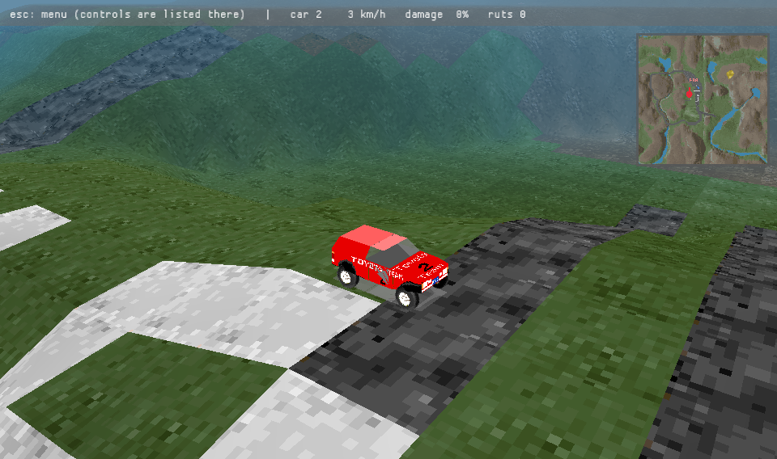
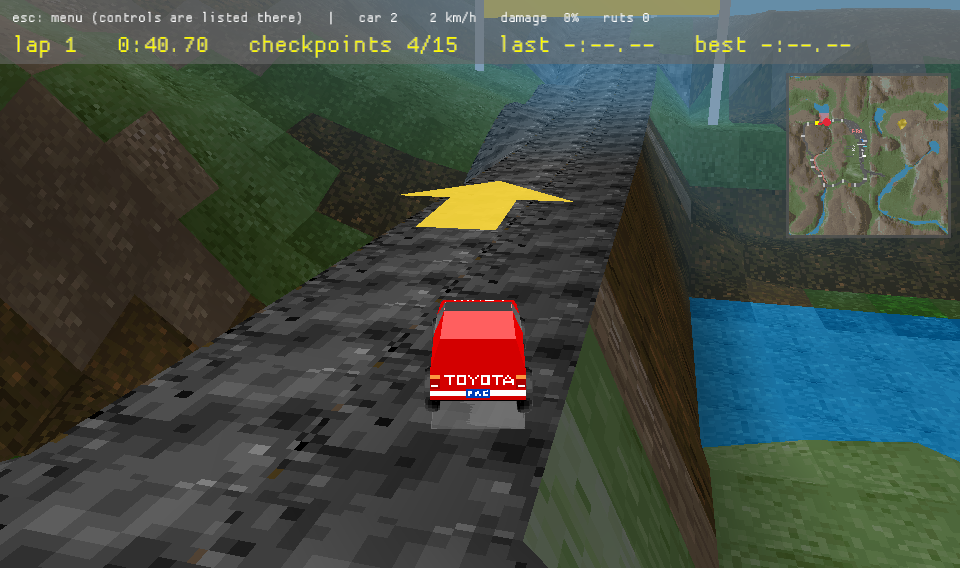
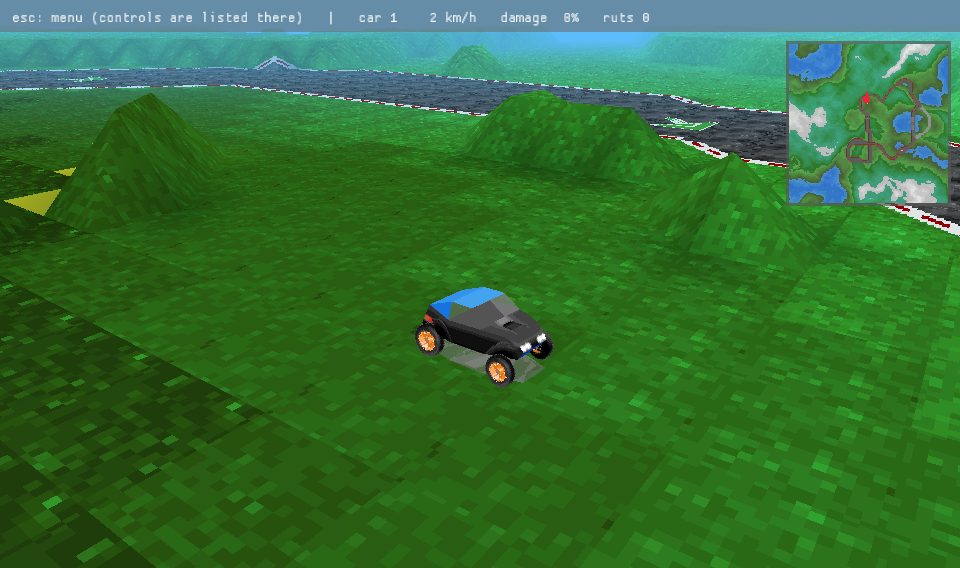
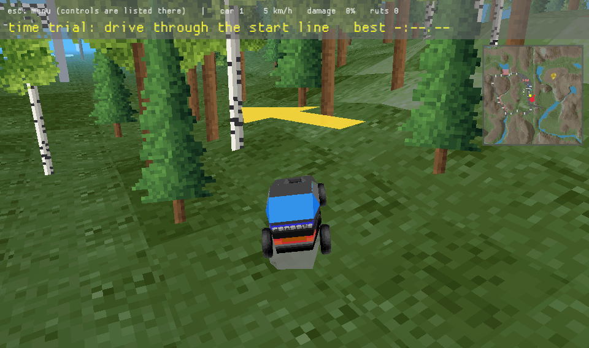
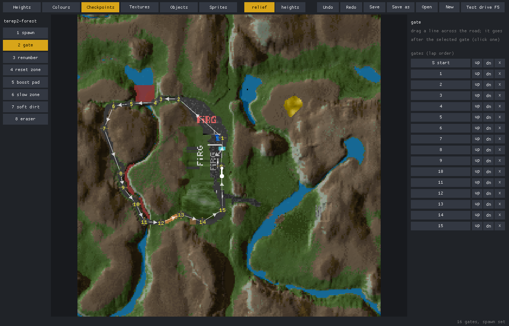

# Reformers

A Rust remake of **-DEFORMERS-** (TEREP2), the 1996–97 DOS soft-body vehicle simulator by
Nagymáthé Dénes. The physics is a literal 16.16 fixed-point port of the original: cars are point
masses joined by springs that yield and break, driven over a 256×256 height map.
How the original works: [docs/re-notes.md](docs/re-notes.md).

| | |
|---|---|
|  |  |
| TEREP2's valley | A time trial: checkpoint arrow, lap timer, minimap |
|  |  |
| A community map, with a community skin | terep2 forest: scenery objects |

## Play

```bash
cargo run --release
```

| Key | Gamepad | Action |
|---|---|---|
| ↑ / ↓ | right trigger or A / left trigger or X | throttle / reverse |
| ← / → | left stick or d-pad | steer |
| Space | B | brake |
| R | Y | put the car back on its wheels (time trial: on the last checkpoint, facing the next); dents stay |
| F | Back | repair the car: hold it to mend the dents from a budget that refills in ~90 s (shown on the HUD); double-tap it for a fresh car at once, which takes a full bar. Esc menu → Race → Repair: instant gives a fresh car on every press instead |
| T | left shoulder | turn the car over where it stands; dents stay |
| 1–5 | | switch car (also Esc menu → Race → Car, with a turning preview; remembered). Race → Skin repaints it with one of the 73 community skins in `assets/skins/` |
| C | right shoulder | camera: chase / bumper / orbit (Q/E rotate) / top-down |
| W | | spring wireframe |
| P | | save this run as a replay |
| F12 | | screenshot: a PNG in `screenshots/` in the data folder (`~/.local/share/reformers/`, `%APPDATA%\reformers\` on Windows), named by the time (UTC); on a Mac keyboard fn + F12. Not in the web build |
| Esc | Start | options (pauses the game); d-pad and A in the menu |

A controller joins once you press one of its buttons, so devices Windows lists as gamepads but
nobody is holding (wheels, pedals, virtual joysticks) can't hold a key down. Its stick and
triggers count once they've been seen at rest, so a HOTAS throttle resting at full doesn't hold
throttle and reverse at once.

Options (saved to `settings.txt` next to the best laps; flags override them): sound volume, camera, fog (the original's distance fog), texture filter (nearest/smooth), textures on (MAPTEX.PCX material tiles, car
skins) or off (flat COL.PCX colours), lighting (the original's flat shading, or baked: soft sun
shadows, sky occlusion and one bounce of coloured light, computed in ~25 ms when a map loads), CRT filter, minimap, ghost car, checkpoint arrow (a yellow arrow over the car pointing at the next checkpoint, on maps that have them), fullscreen, window resolution.

Flags: `--car N` starting car (instead of the remembered one); `--soft` makes all ground diggable so wheels dig tracks (the original
only digs ground of colour 0x0f, which no shipped map has); `--smooth`, `--untextured`, `--crt`, `--baked-light`,
`--no-minimap`, `--ghost`, `--no-fog`, `--mute` preset the options; `--record-audio FILE` writes
what the game plays (engine, skid, thuds) to a WAV while you drive, for checking the sound; `--map NAME` picks a map; `--menu` starts paused.

## Two players

Split screen on one keyboard: Esc menu → Players, or `--players 2` (player 2's car: Race → P2 car). Player 2 drives with WASD, Left
Shift brakes, Tab puts the car back on its wheels, G repairs, H turns it over, and joins beside player 1. Both run
their own time trial with placings (1st/2nd by laps, checkpoints and distance to the next). The
cars collide: the original has collision code but never fills its hull table, so Reformers uses
each car's bounding box (see docs/re-notes.md). Replays are single-player.

Online, up to four players on their own computers (desktop builds; LAN, or the internet with
UDP port 47800 forwarded to the host): one picks Esc → Race → **Host an online race** (or
`--host`), the others **Join**: type the host's address, or pick one found on the LAN with
left/right, then Enter (or `--join ADDRESS`). They wait in the host's lobby; the host presses
Enter on Host to start once everyone's in (`--host N` starts by itself when N cars are in). The
host's map is used, with everyone's own car and skin, on a starting grid; joiners need the same
map files. Each machine shows its own car; the menu doesn't pause an online race; Enter on Host
or Join leaves it. The sims run in lockstep: each player sends only their keys, 33 ms ahead, to
the host, which sends everyone's back, and they compare a state hash every second. A player who
leaves or goes quiet for 5 s just stops, and the race goes on; if the host goes, or the sims
ever disagree, you're back to driving alone. Online laps aren't saved as best laps or ghosts.

## Time trial

When a map has a `CHECK.PCX`, it's a time trial. Drive through the start line to start the
clock, then through the checkpoints in order; any other order doesn't count. The next checkpoint is
the yellow arch (start/finish has a chequered banner); the others are dim. Each arch stands on the
two ends of its painted line. Best laps are saved per map and car in
`~/.local/share/reformers/best_laps.txt` (or `$XDG_DATA_HOME`, or `%APPDATA%` on Windows). The
best lap can also drive along as a translucent ghost car with a dot on the minimap (off by default;
Esc menu or `--ghost`), saved next to it as `ghost-*.bin`.

`CHECK.PCX` is a 256×256 indexed image on the same grid as `MAP.PCX`/`COL.PCX` (the 64 px strip on
the right is a legend and is ignored), so tracks can be painted in any paint program. Like
`COL.PCX`, colour index ÷ 16 is the element type and index mod 16 its setting:

| Indices | Element | Setting |
|---|---|---|
| 0–15 | nothing | – |
| 16–19 | spawn: a small blob, the car starts at its centre | facing up / right / down / left |
| 32–47 | checkpoint: paint a line across the road (1 px is enough) | lap order; the lowest is start/finish, gaps allowed, up to 16. For a fork, paint the same number on each branch: either one counts |
| 48–63 | reset zone: driving in puts the car back like R (paint it over cliffs and water) | – |
| 64–79 | boost pad (cyan on the ground) | strength |
| 80–95 | slow zone, mud (brown on the ground) | strength |
| 96–111 | soft dirt: wheels dig ruts on every pass, up to 6 height steps deep; they stay until the map reloads | – |
| 112–255 | reserved | – |

Respawns put the car on a checkpoint's centre, so centre each line on the drivable road.

The game watches the current map's `MAP`, `COL` and `CHECK` files while it runs: save one in your paint program
and the map reloads within a second (the time trial restarts). A file that fails to load shows an
error and the previous map stays.

## Maps and assets

Each map is a folder in `assets/maps/`: `MAP` (heights) and `COL` (colours = surface materials), as
PCX or TEREP1's BMP, plus an optional `CHECK.PCX` that makes it a time trial. Pick one in the Esc
menu (Race → Map shows each map's minimap and checkpoints; it loads when the menu closes) or
with `--map NAME`; the last one is remembered. Shipped: `terep2` (the original, with the
time-trial track), `terep2-hills` (its unused `MAPHILL.PCX`) and `terep1` (TEREP1's map, same
landscape, own palette; heights use TEREP2's scale, so it comes out gentler). Heights can also be a greyscale `MAP.PNG` or `MAP.PGM` (grey level = height; it wins over
`MAP.PCX`), so any heightmap tool can paint them: save, and the running game reloads the map.
`reform MAP.PNG MAP.PCX` turns one back into a PCX for the DOS game, `reform MAP.PCX MAP.PGM --map`
the other way. A map folder may
carry its own `MAPTEX.PCX`; otherwise the shared one is used when the palettes match, and the
terrain is drawn in flat colours when they don't. Plus 105 community maps from Terep – 30th
Anniversary Edition (free drive: none has checkpoints), each with an `INFO.TXT` holding its name
and credits, shown under the map preview; their origin is in `assets/maps/SOURCES.md`.

A map can also carry scenery (#47): `OBJECTS.PCX`, a 256×256 indexed image on the same grid,
one object per cell (colour index ÷ 16 = kind 1–15, mod 16 = size, 0 = nothing; its palette gives
each kind a colour, brighter when bigger, so it reads in a paint program), drawn from the
sprite sheet `OBJTEX.PCX` (the map folder's own, else the shared `assets/OBJTEX.PCX`): 32×64-pixel
slots, eight per row, kind k in slot k − 1, colour 0 transparent, in the sheet's own palette.
The shared sheet has 1 pine, 2 leafy tree, 3 bush, 4 birch, 5 dead tree, 6 rock. Each object
stands near its cell's centre, nudged and scaled a little by a hash of the cell, and turns to
face the camera. Trunks and rocks are solid: the car's frame stops against them and dents like
in any crash (rocks are low enough to jump; bushes are soft, you drive through them). Each
kind's trunk (radius and height, in world units at size 1) comes from `OBJTEX.TXT` next to the
sheet, one `kind radius height` line per kind, radius 0 = drive through; a kind it doesn't list
gets one measured off its sprite (half its bottom row's width, its height). A map with its own
sheet uses its own `OBJTEX.TXT`, never the shared one. The collision runs in the same fixed-point physics, so it replays and races
online bit-exact; replays and best laps belong to a map's `OBJECTS.PCX` too. `terep2-forest` is
TEREP2's map and track with a forest.

Shared game files live in `assets/` (also found next to the executable, or wherever
`REFORMERS_ASSETS` points): `MAPTEX.PCX`, `TEXTURES.PCX`, `CAR1–5.DAT`, `CAR1.PCX`, `CAR2.PCX`.
They and the map images are the original author's copyrighted work; see `assets/READ.ME`. The
`CHECK.PCX` time-trial track is Reformers' own.

## Credits and licences

- **-DEFORMERS- / TEREP2 and TEREP1** by **Nagymáthé Dénes** (1996–97): the game this remakes.
  The original files in `assets/` (`CAR1–5.DAT`, `CAR1.PCX`, `CAR2.PCX`, `MAPTEX.PCX`,
  `TEXTURES.PCX`, `READ.ME`, `FILE_ID.DIZ`) and the `terep1`, `terep2` and `terep2-hills` maps
  are his work. They stay his, they are not covered by Reformers' licence.
- **Terep – 30th Anniversary Edition**, compiled by **Rezzy** (2026,
  <https://archive.org/details/terep-30th-anniversary-edition>): the 105 community maps in
  `assets/maps/` and the car skins in `assets/skins/`, made by TEREP2 players over the years.
  Every map's makers are credited in its `INFO.TXT` and in `assets/maps/SOURCES.md`; the skins
  are listed in `assets/skins/SOURCES.md`. They stay their makers'.
- **Engine sound loops** in `assets/sounds/engine/`: "racing car engine sound loops" by
  **domasx2** (OpenGameArt), CC0; see `SOURCES.md` there.

The icon (`icon/`) is the original CAR1 on a hill, rendered by Reformers.

Reformers' own code, the `terep2` time-trial track (`CHECK.PCX`), the object sprites
(`assets/OBJTEX.PCX`) and `terep2-forest`'s `OBJECTS.PCX`, the synthesised sounds and the web page
are MIT-licensed, see `LICENSE`.

## Map editor



`cargo run --release --bin editor -- MAP` (or `editor MAP` from a release) edits a whole map:
heights, colours, checkpoints, textures, objects and their sprites, one tab each (F1–F4,
F6, F7; Tab cycles). Without MAP it opens the map you last had open. The layer's tools are on the left (1–8),
the tool's settings on the right, the cell under the mouse at the bottom.

- **Heights:** brush (circle or square, size, hard / smooth / feathered edge; set to a target
  height or raise, Shift lowers), pencil, smooth (also the whole map at once), ramp (drag: from
  the height at the start to the target height, set width), pick. The view shows the ground in
  relief in flat colours or in its MAPTEX textures (zoomed in, the tiles themselves; out, their
  average colours), or the heights as grey.
- **Colours:** brush, pencil, pick. The picker shows the map's MAPTEX tiles: row = surface
  material, column = shade. Hovering a colour shows its material's grip, load and drag next to
  the best material's, and makes its cells blink on the map (Shift: the whole material's). The
  brown dot marks the colour whose dirt digs ruts.
- **Checkpoints:** spawn (arrow keys turn it), gate (drag a line; it goes after the selected
  gate), renumber (click the gates in driving order; Shift-click gives a fork's other branch the
  same number), reset / boost / slow zones, soft dirt, eraser. The gate list on the right
  selects, reorders and deletes; the map shows each gate's number and arrows to the next.
- **Textures:** the map's `MAPTEX.PCX` tile sheet (tile = the texture of one colour: row =
  material, column = shade). Pick a tile on the sheet and paint it zoomed in: pencil, brush,
  fill, pick; strokes wrap at the tile's edges so patterns line up from cell to cell. Noise
  makes a tile from a colour's neighbouring shades; tiles copy and paste; a tiled preview shows
  it as the game lays it. Saved into the map's folder; the shared sheet is never changed.
- **Objects:** trees and the like (`OBJECTS.PCX`). The forest brush fills cells at a density
  with kinds picked at random from the selected sprites (Shift-click mixes kinds) and sizes from
  a range; place one, eraser, pick. Dots on the map; zoomed in, the sprites themselves.
- **Sprites:** the `OBJTEX.PCX` sheet, edited like Textures (pencil, brush, fill, eraser for
  colour 0 = transparent, pick, copy and paste), with RGB sliders for its own palette, and each
  sprite's collider (solid or drive through, trunk radius, height) drawn as a red box on it.
  Saved into the map's folder (`OBJTEX.PCX`, `OBJTEX.TXT`); the shared ones are never changed.

Wheel zooms, right-drag pans, `[` `]` resize, Alt-click picks, Z / Shift+Z undo and redo, S
saves each changed layer back into its own file and format (TEREP1's BMPs as PCX), keeping the
first original as `*.bak`. F5 saves and starts the game on the map; a game already running on it
reloads each save within a second. Open (O) switches to another map (type to filter the list), New makes a flat map (target
height, current colour), Save as copies this one to a new folder.

## Tools

`reform` is the command-line toolbox (in the release archives next to the game and the editor):

```bash
cargo run --release --bin reform -- drive "t:3 tl:2 b:1" out/run   # headless drive → out/run.pgm, out/run_dents.pgm
cargo run --release --bin reform -- assets/maps/terep2/MAP.PCX out/map.pgm --map  # PCX → PGM/PPM/raw f32/raw RGB
cargo run --release --bin reform -- sounds out/sounds                 # the synthesised sounds as WAVs
cargo run --release --bin reform -- car-export CAR1.DAT out/car1.obj  # a car as OBJ + MTL + skin PNG, for Blender
cargo test
```

The engine is a recorded CC0 loop ("racing car engine sound loops" by domasx2, OpenGameArt; full
provenance in `assets/sounds/engine/SOURCES.md`), pitched up at load time into nine speed steps and
crossfaded by wheel speed; without it the game falls back to the original's AdLib engine tone. Everything else is synthesised at start-up: the original's
landing-thud FM patch (played 3 octaves up so speakers can reproduce it), skid noise and
checkpoint/lap chimes.

## Replays

A run is one input byte per tick from the moment the car is placed (the game start, a map or car
change), and the sim is deterministic, so a replay re-drives it exactly. P saves the current run to
`replays/` in the data dir; a best lap also saves the run it ended as `replay-<map>-car<N>.rfr` next
to the best laps. Play one with `--replay FILE`: it picks the replay's map, car and start, drives
by itself, and hands you the keys when it ends. A replay only plays on the exact map files it was
recorded on. The physics avoids platform-dependent maths (a sine table, integer spawn rotation), and a
pinned test (`scripted_drive_is_bit_exact`) runs on every OS in the release workflow to catch drift.

## Web

```bash
web/build.sh                              # needs: rustup target add wasm32-unknown-unknown
python3 -m http.server -d out/web 8000    # then open http://localhost:8000
```

The browser build loads every asset over HTTP at start (`assets/maps/index.txt` lists the maps,
since the web can't list folders). No gamepads, no saved settings or best laps, and no hot reload
there; the rest, CRT filter included, works the same.

## Releases

Publishing a GitHub release runs `.github/workflows/release.yml`: it tests and builds Windows,
macOS (universal) and Linux, and attaches an archive per platform (binaries, `assets/`, this
README). Run the workflow by hand to build without a release; the archives are kept as artifacts.

Issues are tracked on GitHub: https://github.com/kbence/reformers/issues
